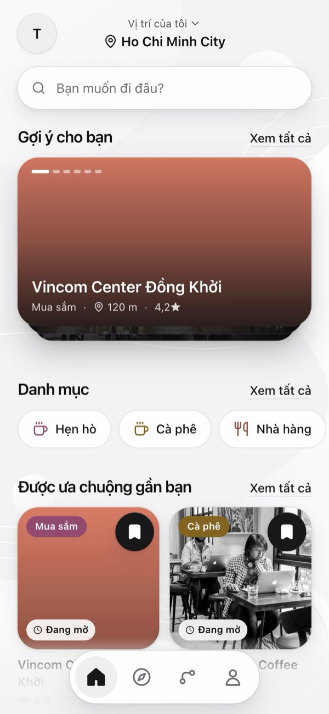
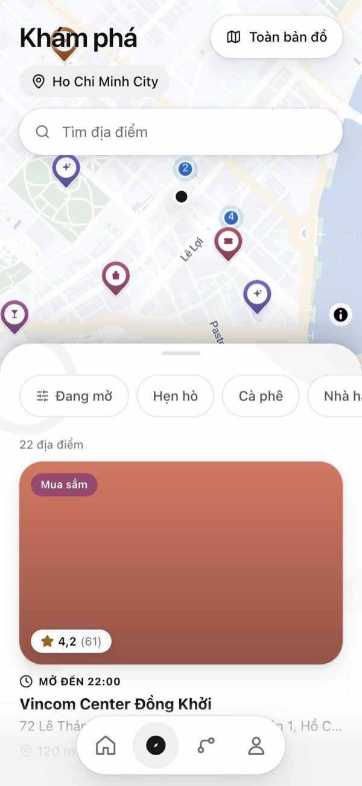
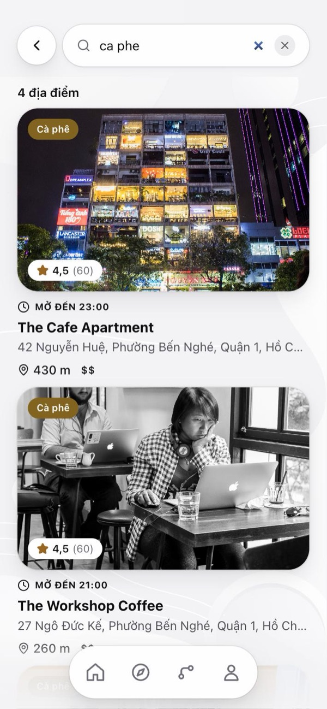
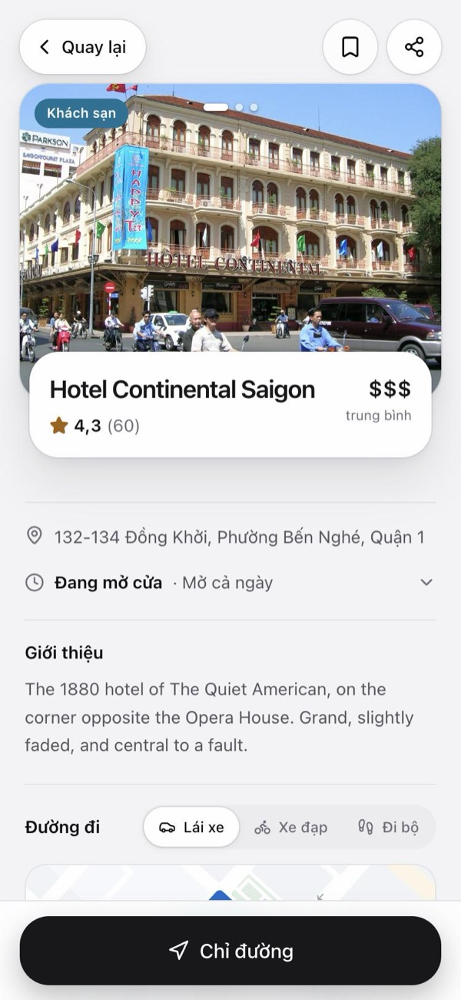
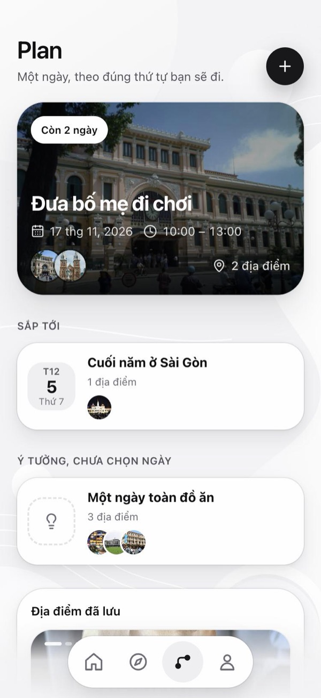
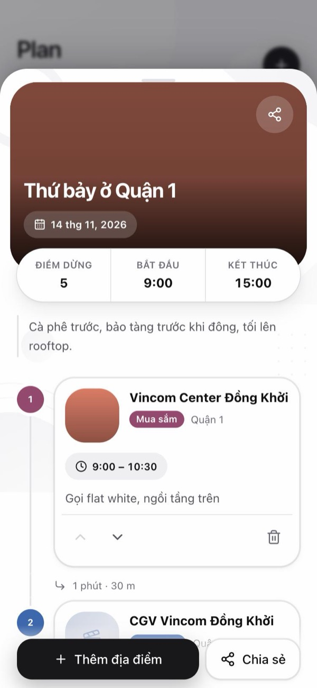
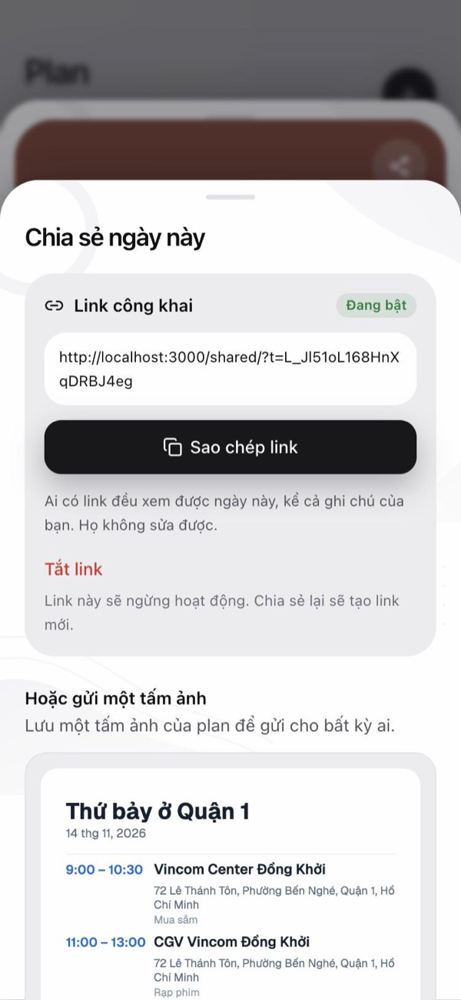
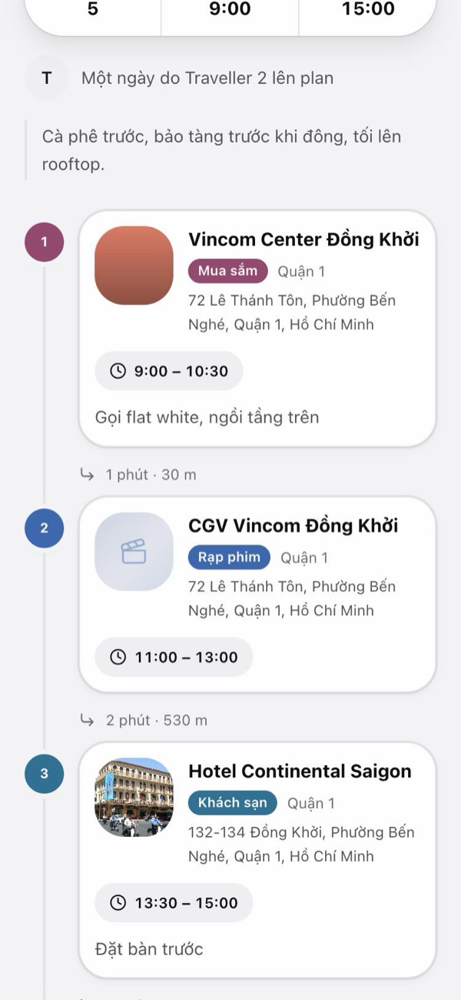
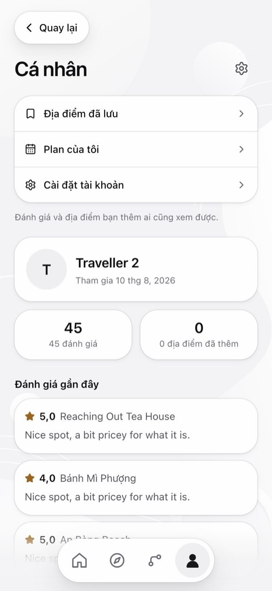

# gonoplan-web

**Gonoplan** is a mobile app for finding where to go in a city you do not know
yet. Open it and it suggests places to eat, drink, see and stay around you —
ranked by how good they actually are nearby, not by who paid — and then helps
you put the ones you like into a day, in order, with the travel time between
them.

This repository is the app's front end. It is written as a web app and ships
two ways from one static build: as an installable PWA in the browser, and as a
native iOS app inside a [Capacitor](https://capacitorjs.com) shell. The API and
the database live in the sibling repository, `gonoplan-api`.

Next.js 16 (static export) · React 19 · TypeScript (strict) · Tailwind CSS v4 ·
TanStack Query · Zustand · MapLibre GL · Capacitor 8

---

## Screenshots

Captured at 375 × 812 against the local seed data. The interface is in
Vietnamese by default; English is one tap away in the profile.

<table>
  <tr>
    <td align="center" width="33%">
      <br>
      <sub><b>Home</b> — ranked suggestions around you</sub>
    </td>
    <td align="center" width="33%">
      <br>
      <sub><b>Explore</b> — map and list, filtered</sub>
    </td>
    <td align="center" width="33%">
      <br>
      <sub><b>Search</b> — works without Vietnamese accents</sub>
    </td>
  </tr>
  <tr>
    <td align="center">
      <br>
      <sub><b>Place</b> — hours, route and reviews</sub>
    </td>
    <td align="center">
      <br>
      <sub><b>Plans</b> — the next day first</sub>
    </td>
    <td align="center">
      <br>
      <sub><b>A day</b> — stops in order, time between them</sub>
    </td>
  </tr>
  <tr>
    <td align="center">
      <br>
      <sub><b>Share</b> — a public link, or a picture</sub>
    </td>
    <td align="center">
      <br>
      <sub><b>Shared plan</b> — opens with no account</sub>
    </td>
    <td align="center">
      <br>
      <sub><b>Profile</b> — what others can see</sub>
    </td>
  </tr>
</table>

---

## What it does

**Discover**
- A home feed of recommendations and themed collections, scored in the
  database by distance, rating and what is open now
- A map with category pins that loads by viewport, and a filterable list beside it
- Search that tolerates missing Vietnamese accents (`ca phe` finds *cà phê*)
- Place pages with photos, opening hours, price range, reviews and directions
  by car, bike or on foot
- Works without location permission: pick a city and everything still runs

**Plan a day**
- Days made of ordered stops, with times, notes and the travel time between
  each pair — flagged when there is not enough time to get from one to the next
- The tab leads with the next day and files the rest as coming up, ideas with
  no date, and past
- Share a day by public link (read-only, revocable) or as an image

**Take part**
- Accounts, with password reset and email verification
- Reviews with photos and helpful votes, check-ins, saved places
- Submitting a new place; owners manage their own listings and see analytics
- Moderation and admin screens for places, reviews, users and reports

**Feel like an app**
- Offline: a service worker keeps the app shell, map tiles and the last
  discovery results, with an offline notice and an install prompt
- 44 pt touch targets, safe areas, no long-press callouts, no pinch-zoom
- Vietnamese and English throughout

---

## Running it

You need Node 22+ and the API running on `:4000` (see `gonoplan-api`).

```bash
cp .env.example .env.local
npm install
npm run dev
```

Open `http://localhost:3000`. During development `next dev` proxies `/api/v1/*`
to the API, so the browser stays on one origin.

### Environment

| Variable | What it is for |
|---|---|
| `API_INTERNAL_URL` | Where `next dev` forwards `/api/v1/*`. Defaults to `http://localhost:4000` |
| `NEXT_PUBLIC_API_URL` | The API origin a **built** app calls directly. Leave empty in `.env.local`; set it in `.env.production.local` |
| `NEXT_PUBLIC_MAP_PROVIDER` | `goong` or `openfreemap`. `openfreemap` needs no key at all |
| `NEXT_PUBLIC_GOONG_MAPTILES_KEY` | Goong's public **maptiles** key only. The REST key belongs in the API and never here |
| `NEXT_PUBLIC_SITE_URL` | Where the web app is served. The iOS build must set it, or shared-plan links point at `capacitor://localhost` |
| `NEXT_PUBLIC_ANALYTICS_ENABLED` | Turns analytics on |

Anything starting with `NEXT_PUBLIC_` is compiled into the bundle and readable
by anyone. [`.env.example`](.env.example) explains each one in full.

### Building

```bash
npm run build
```

This is a static export to `out/`: one HTML file per route, no server.
`postbuild` then writes the service worker's precache list into `out/sw.js`.
Because there is no server, records are linked with query strings —
`/place?p=…`, `/plan?id=…`, `/shared?t=…` — rather than path segments;
[`src/lib/navigation/links.ts`](src/lib/navigation/links.ts) explains why.

### iOS

The same `out/` folder is what the iOS app bundles.

```bash
npm run build
npx cap sync ios
npx cap open ios
```

Inside the app the session is kept in the Keychain rather than a cookie, and
the service worker is not registered — the files are already on the device.

---

## How it is put together

```
src/
├── app/                  routes and layouts only
│   ├── (app)/            the tab shell: bottom nav, safe areas, onboarding
│   ├── (detail)/         pushed screens with no tab bar: a place, a shared plan,
│   │                     password reset, email verification
│   ├── (admin)/          moderation and admin
│   └── offline/          what the service worker shows with no connection
├── components/ui/        the design system — imports nothing from features/
├── components/layout/    shell chrome
├── features/<name>/      components · hooks · api · store, one folder per feature
├── i18n/                 Vietnamese and English catalogues; a missing key is a type error
└── lib/                  API client · query keys · geo · navigation
public/sw.js              the service worker, written by hand
docs/screenshots/         the images above
```

**Where state lives** — the rule that keeps this from becoming a swamp:

| State | Owner |
|---|---|
| Server data | TanStack Query — the only cache |
| Access token | A module closure in `lib/api/client.ts`. Never `localStorage` |
| Session user | Zustand, in memory, not persisted |
| Location | Zustand, persisted (coordinates only, never the permission status) |
| Filters | URL search params |
| Sheet position | Local component state |

Nothing from the API is copied into Zustand. One cache, no sync bugs.

### API types are generated, not written

```bash
npm run contract:sync   # copy openapi.json from ../gonoplan-api (or CONTRACT_URL)
npm run codegen         # contracts/openapi.json → src/types/api.d.ts
```

`contracts/openapi.json` is a pinned copy of the API contract. The two
repositories deploy separately, so this one builds against a known version and
syncing is an explicit commit that shows which endpoints changed. Never edit
`src/types/api.d.ts` by hand; CI fails if it is out of date.

### Mobile details already handled

Each of these fixes something that breaks on a real phone:

- `100dvh`, not `100vh` — iOS Safari's `vh` includes the area behind the URL bar.
- `env(safe-area-inset-*)` through `pt-safe` / `pb-safe-float` / `pb-nav`, with
  a floor so floating UI is not flush to the edge where the inset is `0`.
- Touch targets are at least 44 pt; controls drawn smaller use the `tap-44`
  utility to grow only their hit area.
- `overscroll-behavior-y: none` stops iOS rubber-banding the whole app.
- `touch-action: manipulation` on buttons removes the 300 ms tap delay.
- Pinch-zoom is off, as in a native app. It is also what stops iOS zooming the
  page when a 15 px input takes focus, so turning it back on means raising
  input text to 16 px first. The reasoning and the accessibility cost are in
  [`src/app/layout.tsx`](src/app/layout.tsx).
- Long-pressing a link or photo does not raise Safari's preview sheet, and
  long-pressing a button does not select its label.
- Location permission is a state machine, not a boolean. Denied is a designed
  screen, and the app is fully usable without GPS.
- iOS has no web haptics API; nothing depends on `navigator.vibrate`.

---

## Scripts

| Command | Purpose |
|---|---|
| `npm run dev` | Dev server, with the `/api/v1` proxy |
| `npm run build` | Static export to `out/`, then the service-worker manifest |
| `npm run typecheck` | `next typegen`, then `tsc --noEmit` |
| `npm run lint` · `npm test` | ESLint and Vitest — what CI runs, with `build` and `codegen:check` |
| `npm run contract:sync` | Copy the API contract |
| `npm run codegen` | Regenerate `src/types/api.d.ts` |

---

## More

The architecture, data model, API reference, platform decisions and deployment
guide are in the `docs/` folder of `gonoplan-api`. Start with
`00-architecture.md`.
